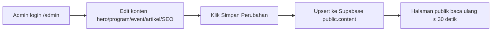

# Admin Flow — CMS `/admin` (Konten Situs)

Alur kerja admin mengelola konten situs publik (hero, program, event, artikel,
SEO, dll) lewat panel `/admin`. **Beda topik** dengan `registrasi-flow.md` (itu
khusus proses registrasi peserta trip). Detail teknis lengkap ada di
`../../README.md` §7–§9 — dokumen ini ringkasan operasional untuk admin harian.

## Arsitektur singkat

`/admin` = halaman statis (prerender), baca/tulis konten **langsung ke Supabase**
dari browser (bukan lewat server Astro). Halaman publik (`/`, `/about`, dll)
baca Supabase tiap request dengan cache 30 detik — jadi begitu admin klik
**Simpan**, perubahan tampil di situs ≤ 30 detik, **tanpa build/deploy**.

## Login

1. Buka `/admin` → form login (email + password).
2. Autentikasi via Supabase Auth (GoTrue REST, bukan SDK).
3. Sesi tersimpan di `localStorage["jagatrip-cms-auth"]`, token berlaku 1 jam, auto-refresh saat reload.
4. User baru **tidak bisa** daftar sendiri (signup dimatikan) — akun dibuat admin via Admin API/Dashboard (lihat README §9).

## Bagian yang bisa dikelola

| Bagian | Tipe | Catatan |
|---|---|---|
| Ringkasan (Overview) | — | statistik + checklist SEO teknikal |
| Hero, About, Founder, Partnership, Footer | Single | form satu objek |
| Programs, Audience, Events, Testimonials, Gallery, FAQs | List | tambah/hapus/urutkan item |
| Articles (News) | Artikel | editor konten + panel SEO per artikel |
| SEO (Pengaturan) | Single | meta global, robots, sitemap |
| Users (Pengaturan) | List statis | tampilan saja, **tidak** membuat user baru dari sini |

## Langkah edit konten (umum)

1. Pilih bagian di sidebar kiri.
2. Isi/ubah field (teks, gambar, select, toggle).
3. Upload gambar → otomatis resize ≤1600px + convert WebP sebelum tersimpan ke bucket `media`. Ganti gambar yang sudah pakai URL bucket lama akan menimpa file yang sama (tidak ada file yatim).
4. Status "belum disimpan" (dirty) muncul di header saat ada perubahan.
5. Klik **Simpan Perubahan** → upsert ke `public.content`. **Tidak ada tombol Publish terpisah.**
6. Tombol **Export JSON** — unduh snapshot konten saat ini (buat backup manual sebelum perubahan besar).

## Langkah khusus: Artikel (News)

1. Sidebar → **Articles** → **+ Artikel baru** (atau pilih artikel existing → Edit).
2. Isi field konten: title, slug, category, author, date, status (Draft/Published), excerpt, cover, body.
3. Isi field SEO di panel kanan: metaTitle, metaDescription, focusKeyword, canonical, imageAlt, ogImage, schemaType, index/follow.
4. Perhatikan **skor Kelengkapan SEO** (realtime) — ini cek kelengkapan isian form, **bukan** prediksi ranking Google.
5. `status = Published` → langsung tampil di `/news` & `/news/<slug>`. `Draft` → tidak tampil di publik.
6. Simpan seperti biasa.

## Catatan penting / batasan

- **Tidak ada role permission nyata** — `admin` dan `super_admin` bisa akses semua bagian yang sama. Pembatasan hak harus ditambahkan di level RLS Supabase kalau dibutuhkan.
- **Field tersembunyi**: `icon`, `long`, `who`, `points` (program), `flyerAlt` (event) **tidak ada di form admin** — diambil otomatis dari `defaults.ts` dicocokkan by judul. Ganti judul program di admin = detail-detail ini hilang (fallback kosong/`desc`).
- **Supabase down / env kosong** → situs otomatis fallback ke `defaults.ts`, tidak pernah 500 — tapi berarti perubahan admin tidak akan terlihat sampai Supabase pulih.

## Troubleshooting cepat

| Gejala | Kemungkinan sebab | Cek |
|---|---|---|
| Simpan sukses tapi situs publik belum berubah | Masih dalam window cache 30 detik, atau isolate Worker lain belum refresh | Tunggu ±30 detik, hard refresh |
| Tidak bisa login | Signup provider belum dimatikan / salah kredensial / token Auth bermasalah | Cek Supabase Dashboard → Authentication → Users; reset password dari sana |
| Upload gambar gagal | Belum login (fallback data URL lokal, tidak tersimpan permanen) atau bucket `media` RLS belum di-setup | Cek login status, jalankan migrasi `supabase/migrations/20260929_content.sql` |
| Field program/event hilang detailnya setelah edit | Judul diganti, field tersembunyi (`icon`/`long`/dll) dicocokkan by judul lama | Samakan judul, atau tambahkan field eksplisit di admin bila perlu permanen |

> ponytail: role admin/super_admin sama-sama full access, belum ada enforcement
> hak akses granular. Upgrade ke RLS per-role di Supabase kalau butuh pemisahan
> hak (mis. staff cuma boleh edit artikel, bukan hero/SEO global).
