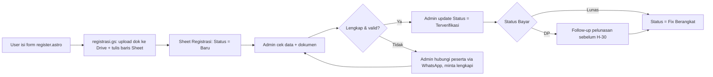

# Admin Flow — Registrasi Peserta

Alur kerja admin/CS memproses data yang masuk dari form `register.astro`
sampai peserta terkonfirmasi berangkat. Lihat juga:
`../appscript/registrasi.md` (setup backend) dan
`../files/registrasi.md` (struktur folder Drive).

## Alur singkat

## Langkah detail

1. **Cek masuk baru** — buka sheet `Registrasi`, filter kolom `Status = Baru`.
2. **Verifikasi dokumen** — buka link di kolom `File Paspor`, `File KTP`, `File Pas Foto Visa`, `File KTP & KK`, `File Itinerary Visa`, `File Bukti Saldo`, `Bukti Transfer`. Cek:
   - File terbaca jelas (bukan blur/gelap).
   - Masa berlaku paspor (`Expired Paspor`) masih valid ≥ 6 bulan dari tanggal keberangkatan.
   - Nominal/bukti transfer sesuai `Status Bayar` (DP/Lunas).
3. **Update kolom `Status`** manual di sheet:
   - `Baru` → data masuk, belum dicek.
   - `Terverifikasi` → dokumen & pembayaran lengkap/valid.
   - `Revisi` → ada dokumen kurang/salah, sudah dihubungi via WA.
   - `Fix Berangkat` → lunas + semua dokumen approved.
4. **Follow-up WA** — pakai nomor di kolom `WhatsApp`. Dua skenario:
   - Dokumen kurang/salah → minta kirim ulang.
   - `Status Bayar = DP` → ingatkan pelunasan sebelum H-30 keberangkatan.
5. **Rekap final** — H-7 sebelum berangkat, tarik semua baris `Status = Fix Berangkat` untuk manifest peserta (nama, no paspor, kota asal, bandara).

## Catatan keamanan data

- **Jangan** screenshot/forward isi sheet (no paspor, no WA, bukti transfer) ke grup terbuka. Kalau perlu share ke tim lain, anonimkan dulu (hilangkan kolom WA/no paspor) atau share akses sheet langsung dengan role view terbatas.
- Baris dengan `Source = TEST` (dari `testDoPost()` di `registrasi.gs`) **hapus**, bukan data peserta asli.
- Link dokumen bersifat "anyone with link" — jangan sebar link individual di luar kebutuhan verifikasi.

## Troubleshooting cepat

| Gejala | Kemungkinan sebab | Cek |
|---|---|---|
| Baris baru tidak muncul di sheet | Apps Script belum di-deploy / `APPS_SCRIPT_URL` di `register-handler.ts` belum diupdate | `../appscript/registrasi.md` §Troubleshooting |
| Link dokumen error "need access" | File belum ke-share saat upload (jarang, biasanya `setSharing` gagal) | Buka file manual di Drive, share ulang "anyone with link" |
| Peserta bilang sudah submit tapi tidak ada datanya | Kemungkinan form gagal submit (network) sebelum sampai ke script | Minta screenshot pesan error terakhir, cek `wa` di `jagatrip_submitted_phones` kalau peserta kirim screenshot localStorage |

> ponytail: status diupdate manual di sheet, belum ada dashboard admin terpisah
> untuk flow ini. Upgrade ke view/filter khusus (atau halaman `/admin`) kalau
> volume registrasi per batch trip mulai besar dan manual filtering jadi lambat.
