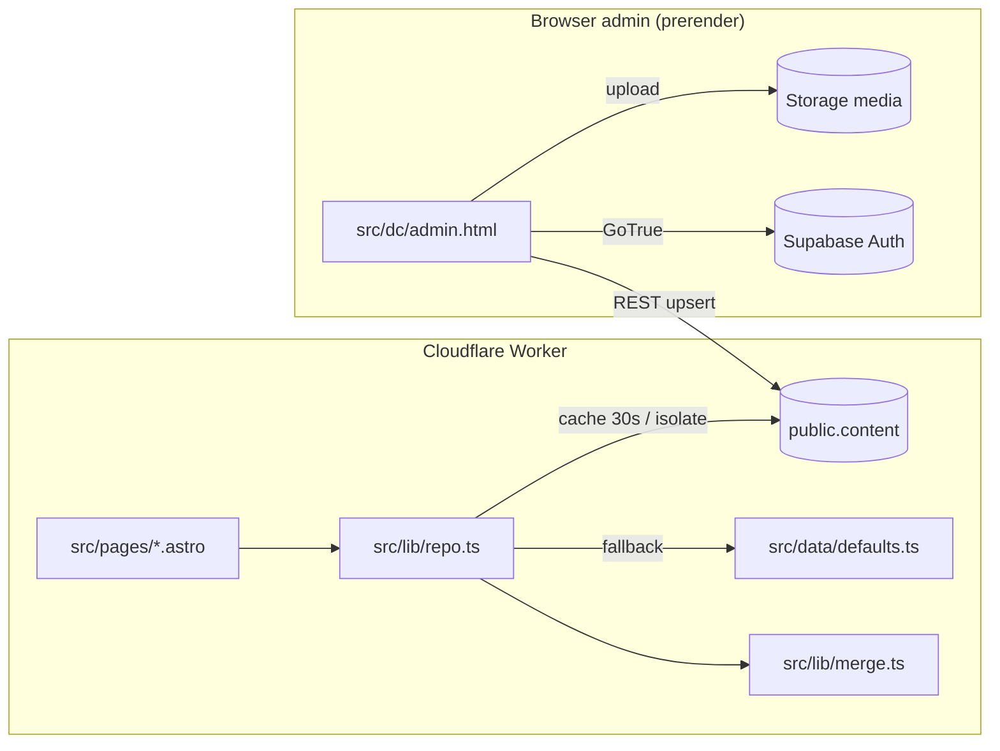

# Arsitektur

Gambaran sistem untuk developer: komponen, aliran data, dan keputusan desain
yang tidak boleh dilanggar. Ringkasan singkat ada di README §1; detail
database di `database.md`, deploy di `deployment.md`. Aturan untuk AI agent
ada di `AGENTS.md` root.

## 1. Komponen

| Komponen | Teknologi | Peran |
|---|---|---|
| Situs publik | Astro 7 SSR (`output: 'server'`) di Cloudflare Workers | render tiap request, baca konten dari Supabase |
| Panel admin `/admin` | halaman prerender (`export const prerender = true`) + SPA `src/dc/admin.html` | edit konten langsung ke Supabase dari browser |
| Data konten | Supabase Postgres `public.content` (jsonb per section) | satu-satunya sumber konten dinamis |
| Gambar | Supabase Storage bucket `media` | upload dari admin, URL disimpan di `content` |
| Auth admin | Supabase Auth (GoTrue REST, tanpa SDK) | login email/password |
| Form registrasi LP | Google Apps Script + Sheet + Drive | di luar Supabase, lihat `../appscript/` |
| Konten statis lama | `src/content/trips/*.md` (content collection) | hanya dipakai `src/legacy/` |
| Ops | GitHub Actions `keepalive.yml`, `security.yml`, `codeql.yml` | jaga Supabase aktif, scan keamanan |

## 2. Aliran data

1. Request masuk Worker → page memanggil `getSite()`/`getPrograms()`/dst dari
   `repo.ts`.
2. `repo.ts` cek cache in-memory (30 detik per isolate). Basi → `GET
   /rest/v1/content?select=key,data` pakai anon key.
3. Baris jsonb digabung ke `defaults.ts` lewat `merge.ts` (status
   `Aktif`/`Tampil` → boolean; `icon`/`points`/`flyerAlt` dicocokkan by title
   dari defaults).
4. Fetch gagal / env kosong → `defaults.ts` apa adanya. Tidak pernah 500.
5. Admin simpan = upsert ke `content`. Tidak ada build/deploy; publik ikut
   berubah ≤ 30 detik.

## 3. Keputusan desain (dan alasannya)

| Keputusan | Alasan | Jangan |
|---|---|---|
| SSR, bukan static build per perubahan konten | admin non-teknis tidak perlu tunggu/pantau deploy | bikin ulang tombol Publish / deploy hook (`public.deploys` sudah di-drop) |
| Satu pintu data `repo.ts` | satu tempat untuk cache, fallback, dan mapping | `fetch` Supabase atau import `defaults.ts` langsung dari page |
| Admin prerender + logic client-side | logic admin (localStorage session, upload canvas) butuh browser; prerender lepas dari cache 30s | ubah `/admin` jadi SSR |
| Tanpa SDK Supabase | REST cukup, hemat bundle, tidak ada dependency tambahan | tambah `@supabase/supabase-js` |
| Konten jsonb per section | shape = state admin, tidak perlu migrasi per field | normalisasi tabel sebelum ada kebutuhan query/relasi (lihat README §15) |
| Fungsi plain di `src/lib/*.ts` | kode kecil, mudah dites dengan `bun test` | class/service layer/ORM |

## 4. Batas & jalur upgrade

Semua penyederhanaan sengaja ditandai `ponytail:` di kode. Daftar lengkap +
upgrade path di README §15. Yang paling sering kena:

- Cache per isolate, bukan global → Cloudflare Cache API / KV bila traffic
  tinggi.
- Detail program by title dari `defaults.ts` → tambah field ke form admin,
  hapus `byTitle` di `merge.ts`.
- Role admin hanya label → RLS policy berbasis `user_metadata.role`.

ponytail: tidak ada diagram deployment infra (DNS, zona Cloudflare) — hanya
satu Worker + satu project Supabase. Tambah bila ada staging/multi-env.
