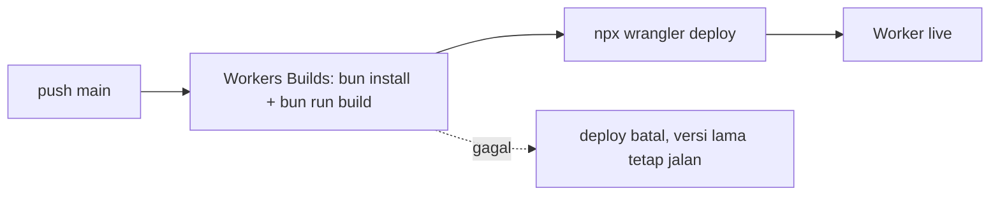

# Deployment

Cara situs sampai ke produksi (Cloudflare Workers), env yang dibutuhkan,
checklist rilis, dan rollback. Setup lokal ada di `development.md`; masalah
umum di `troubleshooting.md`.

## 1. Target

| Komponen | Di mana | Cara deploy |
|---|---|---|
| Situs publik + `/admin` | Cloudflare Workers (`wrangler.jsonc`: name `jagatrip-cms`, assets `./dist/client`) | push ke `main` → Workers Builds otomatis |
| Skema DB | Supabase | manual, SQL Editor (lihat `database.md` §5) |
| Apps Script LP | Google Apps Script editor | manual copy-paste + New version (lihat `../appscript/rule.md` §3) |

Tidak ada staging. Satu Worker, satu project Supabase.

## 2. Konfigurasi Cloudflare (sekali)

Workers & Pages → Create → Import repo Git.

| Setting | Nilai |
|---|---|
| Build command | `bun run build` |
| Deploy command | `npx wrangler deploy` |
| Build vars | `PUBLIC_SUPABASE_URL`, `PUBLIC_SUPABASE_ANON_KEY` |
| `BUN_VERSION` | `1.4.2` — hanya bila error `Unknown lockfile version` |

Var `PUBLIC_*` di-inline saat build (ke `/admin` dan ke `repo.ts` di
Worker). Ubah nilai = harus **rebuild**, bukan sekadar restart.

**Jangan** taruh `SUPABASE_SERVICE_ROLE_KEY` di Cloudflare — tidak dipakai
Worker, dan bila bocor = bypass semua RLS.

## 3. Alur deploy normal

Konten **tidak** butuh deploy — admin simpan → Supabase → publik baca tiap
request. Deploy hanya untuk perubahan kode/`defaults.ts`.

## 4. Checklist rilis

1. `bun test` dan `bun run build` lulus lokal.
2. Bila ada migration SQL baru: jalankan di Supabase **sebelum** push (kode
   baru mungkin baca field yang belum ada; fallback defaults akan menutupi,
   tapi admin bisa error).
3. Push ke `main`, tunggu build hijau di Cloudflare.
4. Cek `/admin` → login OK, bukan "Konfigurasi Supabase kosong".
5. Cek `view-source:` satu artikel → canonical / `og:image` benar.
6. Edit satu field di admin → Simpan → refresh publik ≤ 30 detik → berubah.
7. Bila ubah `.gs`: sync ke Apps Script editor + New version, test submit
   form LP.

## 5. Rollback

- **Kode**: Cloudflare Dashboard → Worker → Deployments → pilih versi
  sebelumnya → Rollback. Instan, tidak perlu rebuild.
- **Konten**: tidak ada versi di DB. Pakai Export JSON terakhir dari admin
  (lihat `database.md` §7), atau edit ulang manual.
- **Migration**: tulis migration kebalikan (`drop column ...`) sebagai file
  baru; jangan edit file lama.
- **Apps Script**: Deploy → Manage deployments → pilih versi lama.

## 6. Monitoring minimal

| Apa | Cara |
|---|---|
| Error runtime Worker | `wrangler tail` lokal (butuh login Wrangler), atau Dashboard → Worker → Logs |
| Supabase gagal dibaca | log `[repo] Supabase gagal, pakai defaults:` di Worker |
| Supabase paused | `.github/workflows/keepalive.yml` gagal → notif GitHub |
| Vuln/secret di repo | `security.yml` (Trivy) + `codeql.yml` tiap push/PR/Senin |

ponytail: tidak ada uptime monitor eksternal dan tidak ada alert saat
fallback defaults aktif terus-menerus. Upgrade: Cloudflare Health Check /
UptimeRobot ke `/` + cek string unik dari konten Supabase.
