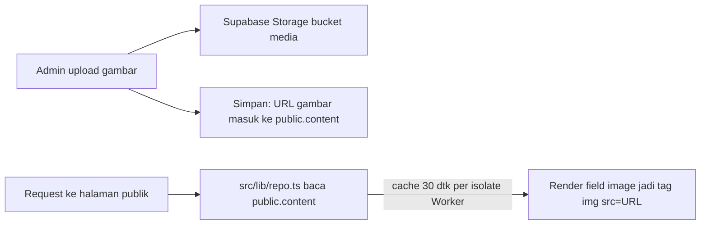

# Rule Penyimpanan File Admin — Supabase Storage

Aturan penyimpanan gambar yang diupload dari panel `/admin` (field tipe
`image`: Hero, Founder, Gallery, Event flyer, Article cover, OG image, dll —
daftar lengkap field per menu ada di `../admin/update-content-guide.md`).

**Beda topik** dengan `registrasi.md` (itu dokumen peserta trip, disimpan
di Google Drive, bukan Supabase).

## 1. Lokasi: bucket `media`

Semua gambar admin disimpan di satu bucket Supabase Storage: **`media`**
(dibuat via `supabase/migrations/20260929_content.sql`).

| Setting | Nilai |
|---|---|
| Public | ya — siapa saja bisa baca lewat URL publik |
| Limit ukuran file | 5 MB/file |
| MIME diizinkan | `image/webp`, `image/jpeg`, `image/png` |
| Siapa boleh upload/ganti/hapus | hanya user yang login (`authenticated`), lihat RLS di migrasi |

Tidak ada subfolder per menu — semua gambar flat di root bucket `media`
(beda dengan Drive registrasi yang dipisah subfolder per jenis dokumen).

## 2. Proses upload otomatis (dari admin)

Saat admin pilih file di field `image`:

1. Browser resize gambar ke maksimal **1280px** sisi terpanjang, convert ke
   **WebP kualitas 0.78** (dilakukan di browser via `<canvas>`, bukan server).
2. Preview lokal langsung tampil (optimistic) sebelum upload selesai.
3. File diupload ke `POST /storage/v1/object/media/<nama>.webp` pakai token
   login admin, header `x-upsert: true` (timpa kalau nama sama).
4. Field form otomatis terisi URL publik:
   `<PUBLIC_SUPABASE_URL>/storage/v1/object/public/media/<nama>.webp`.
5. Admin klik **Simpan Perubahan** → URL ini ikut ter-upsert ke tabel
   `public.content`.

**Tidak perlu upload manual ke Supabase Dashboard** — semua lewat form admin.

## 3. Aturan penamaan file

- **Gambar baru** (field masih kosong/belum pernah pakai URL bucket `media`):
  nama file = UUID acak (`crypto.randomUUID()`), mis. `a1b2c3d4-....webp`.
- **Ganti gambar yang sudah pakai URL bucket `media`**: nama file **dipertahankan**
  (diambil dari URL lama), file lama **ditimpa** (`x-upsert: true`) — supaya:
  - URL tidak berubah → tidak perlu update apa pun lagi, field otomatis tetap valid.
  - Tidak menyisakan file lama "yatim" (orphan) menumpuk di bucket.
- Konsekuensi: **jangan rename/pindah file manual** di Supabase Dashboard
  Storage — field di `content` menyimpan URL lengkap, kalau nama file berubah
  manual maka gambar di halaman publik langsung putus (404).

## 4. Kenapa otomatis update ke halaman utama (tanpa deploy)

Alur baca halaman publik (lihat juga `../admin/cms-flow.md`):

- `src/lib/repo.ts` fetch `public.content` **tiap request** (bukan saat build),
  dengan cache in-memory 30 detik per isolate Cloudflare Worker.
- Field `image` di admin cuma menyimpan **URL string**, bukan file binary, ke
  tabel `content` — jadi begitu URL baru tersimpan, halaman publik otomatis
  ambil URL baru itu di request berikutnya (≤ 30 detik), tanpa build/deploy.
- Gambar sendiri langsung bisa diakses publik begitu upload sukses (bucket
  `public = true`), jadi tidak ada jeda propagasi di sisi Storage — jeda
  ≤ 30 detik murni dari cache `repo.ts`.

## 5. Checklist upload gambar admin

- [ ] Ukuran file asli < 5 MB (lebih besar akan ditolak Storage).
- [ ] Format asli JPG/PNG/WebP (format lain ditolak saat browser proses, atau ditolak Storage kalau somehow lolos resize).
- [ ] Isi **alt text** di field sebelahnya kalau ada (SEO/aksesibilitas) — resize/upload tidak otomatis isi alt text.
- [ ] Setelah klik Simpan, hard refresh halaman publik ±30 detik kemudian untuk konfirmasi gambar baru tampil.
- [ ] Kalau ganti gambar lama, **jangan** khawatir file lama menumpuk — otomatis ditimpa (lihat §3), tidak perlu hapus manual.

## 6. Batasan & kapan perlu akses Dashboard manual

- Hapus gambar yang **sudah tidak dipakai field mana pun** (mis. field pernah
  diisi lalu dikosongkan, bukan diganti) — ini **tidak otomatis terhapus**
  dari bucket, jadi bisa jadi file orphan. Cek manual di Supabase Dashboard →
  Storage → `media` sesekali kalau mau bersih-bersih.
- Reset ukuran/kualitas kompresi (1280px / 0.78) hanya bisa diubah di kode
  (`src/dc/admin.html`), bukan dari UI admin.

> ponytail: tidak ada proses otomatis bersihkan file orphan di bucket `media`.
> Upgrade: cron/Edge Function yang bandingkan daftar URL di `public.content`
> vs isi bucket, hapus yang tidak direferensikan — baru perlu kalau bucket
> mulai penuh/berantakan.
